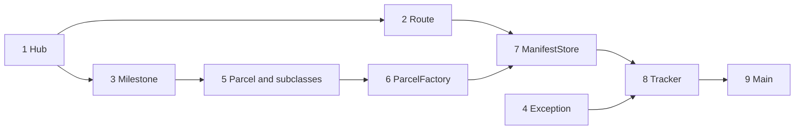

# 🧑‍🏫 Build Guide: From Empty Folder to Finished Program

> **Written for:** Group 8 members who write the Java code and are new to Java projects.

This guide uses only [PROJECT-SPEC.md](PROJECT-SPEC.md), [BUILD-OVERVIEW.md](BUILD-OVERVIEW.md), and [DESIGN-SKETCH.md](DESIGN-SKETCH.md). It does not use any existing code file. The code is the simplest form that core Java allows. Review each block, then create the file and paste it in.

## 📖 Table of contents

- [Decisions this guide makes](#-decisions-this-guide-makes)
- [Start here](#-start-here)
- [Build order](#-build-order)
- [Step 1: Hub](#-step-1-hub)
- [Step 2: Route](#-step-2-route)
- [Step 3: Milestone](#-step-3-milestone)
- [Step 4: InvalidTrackingIdException](#-step-4-invalidtrackingidexception)
- [Step 5: Parcel and the speed subclasses](#-step-5-parcel-and-the-speed-subclasses)
- [Step 6: ParcelFactory](#-step-6-parcelfactory)
- [Step 7: ManifestStore](#-step-7-manifeststore)
- [Step 8: Tracker](#-step-8-tracker)
- [Step 9: Main](#-step-9-main)
- [Test the whole program](#-test-the-whole-program)
- [Finish line](#-finish-line)

## 📌 Decisions this guide makes

The spec leaves some points open. The group answered four of them. The guide fills the other gaps with the smallest choice that works.

| Point | Decision | Source |
| --- | --- | --- |
| How speeds differ | Each speed stores its own delivery days and its own cost. | Group answer |
| Valid tracking ID | The ID starts with `ORD` and has only digits after it, for example `ORD1001`. | Group answer, digit count is open |
| File format | Comma-separated lines. The status log holds a time stamp. | Group answer |
| Interface | Command line only, as in the sample session. | Group answer |
| Delivery days and cost values | `5` days and `50.0` for Standard, `2` and `100.0` for Express, `1` and `200.0` for Overnight. | Placeholder, the group must set the real values |
| Unknown but well-formed ID | The program throws the same exception with the message `Parcel not found`. | Needed for the code to work |
| Next ID | The program saves the last used order number in `last-id.txt`. The first ID is `ORD1001`. | Group request: keep the number after the program ends |
| Extra classes | `Route`, `ParcelFactory`, and `Tracker` hold work that does not fit the clear job of `Hub`, `Parcel`, and `Main`. | Group request: one clear job for each file |

> [!IMPORTANT]
> The placeholder values and the digit count of the ID are not in any source. Agree on them as a group before the final test.

## 🚀 Start here

1. Install a JDK (Java Development Kit). Run `java -version` and `javac -version` in a terminal to make sure that both commands work.
2. Create one empty folder for the program. Open a terminal in that folder.
3. Create each file below in that folder, in the order of the steps. Use the exact file names.
4. Run the compile command from each step. Fix any error before you go on.

> [!WARNING]
> The repository root already holds files named `Parcel.java` and `Stats.java` and others. Do not mix this guide's files with them. Use the new empty folder, or move the old files away first.

All files sit in one folder and have no `package` line. This is the simplest setup.

The code uses an OOP feature only where the project needs it. The speed classes need inheritance, so each one extends `Parcel`. `Milestone` needs two constructors because an event is either new or read from a file. Fields are private because each class guards its own data. The [Finish line](#-finish-line) section shows where each one appears. The only `static` keyword besides `main` is in `ParcelFactory`.

## 🧭 Build order

Each step needs only the steps before it. Each file has one job.



| Step | File | Its one job |
| --- | --- | --- |
| 1 | `Hub.java` | Holds the name of one hub. |
| 2 | `Route.java` | Holds the four hubs in order and finds the next hub. |
| 3 | `Milestone.java` | Holds one tracking event: a hub and a time. |
| 4 | `InvalidTrackingIdException.java` | Signals a bad tracking ID. |
| 5 | `Parcel.java`, `StandardParcel.java`, `ExpressParcel.java`, `OvernightParcel.java` | Hold one shipment and its history. Each speed has its own days and cost. |
| 6 | `ParcelFactory.java` | Builds the right parcel for a speed name. |
| 7 | `ManifestStore.java` | Reads and writes the text files. |
| 8 | `Tracker.java` | Runs the three commands: add, advance, and track. |
| 9 | `Main.java` | Reads the command line and prints the result. |

## 🏢 Step 1: Hub

A `Hub` is one stop on the route. It holds only a name.

Create `Hub.java`:

```java
public class Hub {

    // Private field: only this class can change it
    private String name;

    public Hub(String name) {
        this.name = name;
    }

    public String getName() {
        return name;
    }
}
```

Compile: `javac Hub.java`

## 🚏 Step 2: Route

The `Route` holds the four hubs in travel order. It knows which hub comes after another hub.

Create `Route.java`:

```java
public class Route {

    // The four hubs, in travel order
    private Hub[] hubs = new Hub[4];

    // The constructor runs once, when we write: new Route()
    public Route() {
        hubs[0] = new Hub("Dispatch");
        hubs[1] = new Hub("Sorting Facility");
        hubs[2] = new Hub("Out-for-Delivery");
        hubs[3] = new Hub("Delivered");
    }

    public Hub getFirst() {
        return hubs[0];
    }

    // Returns the hub after the given hub, or null if the given hub is the last one
    public Hub getNext(Hub current) {
        for (int i = 0; i < hubs.length - 1; i++) {
            if (hubs[i] == current) {
                return hubs[i + 1];
            }
        }
        return null;
    }

    // Finds a hub by its name. We need this when we read the files. Returns null if not found
    public Hub findByName(String name) {
        for (int i = 0; i < hubs.length; i++) {
            if (hubs[i].getName().equals(name)) {
                return hubs[i];
            }
        }
        return null;
    }
}
```

Compile: `javac Route.java`

## 🕒 Step 3: Milestone

A `Milestone` is one tracking event. It holds a hub and the time the parcel reached it. The time is plain text.

The class has two constructors with the same name and different inputs. This is constructor overloading. Java picks the one that matches the inputs.

Create `Milestone.java`:

```java
import java.util.Date;

public class Milestone {

    private Hub hub;
    private String time;

    // Constructor 1: a new event. The time is now
    public Milestone(Hub hub) {
        this.hub = hub;
        this.time = new Date().toString(); // the time now, as text
    }

    // Constructor 2: an old event that we read from the status log. The time is given
    public Milestone(Hub hub, String time) {
        this.hub = hub;
        this.time = time;
    }

    public Hub getHub() {
        return hub;
    }

    public String getTime() {
        return time;
    }
}
```

Compile: `javac Milestone.java`

## 🚫 Step 4: InvalidTrackingIdException

This class is the exception for a bad tracking ID. It extends `Exception`, so Java forces the caller to handle it. This is a checked exception.

Create `InvalidTrackingIdException.java`:

```java
public class InvalidTrackingIdException extends Exception {

    // The message is passed up to the Exception class
    public InvalidTrackingIdException(String message) {
        super(message);
    }
}
```

Compile: `javac InvalidTrackingIdException.java`

## 📦 Step 5: Parcel and the speed subclasses

`Parcel` holds what every parcel has: an ID, a current hub, and a history. It stores the speed name, the delivery days, and the cost in fields. The getters only return those fields.

The program creates one of the three speed classes, not a plain `Parcel`. Each speed class extends `Parcel`. It passes its own speed name, days, and cost to the `Parcel` constructor with `super`.

Create `Parcel.java`:

```java
import java.util.ArrayList;

public class Parcel {

    private String trackingId;
    private String speedName;
    private int deliveryDays;
    private double cost;
    private Hub currentHub;
    private ArrayList<Milestone> history = new ArrayList<Milestone>();

    // The speed classes pass their own speed, days, and cost to this constructor
    public Parcel(String trackingId, String speedName, int deliveryDays, double cost) {
        this.trackingId = trackingId;
        this.speedName = speedName;
        this.deliveryDays = deliveryDays;
        this.cost = cost;
    }

    public String getTrackingId() {
        return trackingId;
    }

    public String getSpeedName() {
        return speedName;
    }

    public int getDeliveryDays() {
        return deliveryDays;
    }

    public double getCost() {
        return cost;
    }

    public Hub getCurrentHub() {
        return currentHub;
    }

    public void setCurrentHub(Hub hub) {
        currentHub = hub;
    }

    // Adds an old event. We use it when we read the status log
    public void addMilestone(Milestone milestone) {
        history.add(milestone);
    }

    // Moves the parcel to a hub and records the event. Returns the event so it can be logged
    public Milestone advanceTo(Hub hub) {
        Milestone milestone = new Milestone(hub); // constructor 1: the time is now
        currentHub = hub;
        history.add(milestone);
        return milestone;
    }

    // Builds the text for the track command
    public String getHistoryText() {
        String text = "Tracking history for " + trackingId + " (" + getSpeedName() + ")\n";
        for (int i = 0; i < history.size(); i++) {
            Milestone m = history.get(i);
            text = text + (i + 1) + ". " + m.getHub().getName() + " (" + m.getTime() + ")\n";
        }
        text = text + "Delivery days: " + getDeliveryDays() + "\n";
        text = text + "Cost: " + getCost() + "\n";
        return text;
    }
}
```

Create `StandardParcel.java`:

```java
public class StandardParcel extends Parcel {

    // super(...) calls the Parcel constructor. The days and cost are PLACEHOLDERS: the group sets the real values
    public StandardParcel(String trackingId) {
        super(trackingId, "Standard", 5, 50.0);
    }
}
```

Create `ExpressParcel.java`:

```java
public class ExpressParcel extends Parcel {

    // The days and cost are PLACEHOLDERS: the group sets the real values
    public ExpressParcel(String trackingId) {
        super(trackingId, "Express", 2, 100.0);
    }
}
```

Create `OvernightParcel.java`:

```java
public class OvernightParcel extends Parcel {

    // The days and cost are PLACEHOLDERS: the group sets the real values
    public OvernightParcel(String trackingId) {
        super(trackingId, "Overnight", 1, 200.0);
    }
}
```

Compile: `javac Parcel.java StandardParcel.java ExpressParcel.java OvernightParcel.java`

## 🏭 Step 6: ParcelFactory

Two other classes need to turn a speed name into the right parcel. This class does that in one place. The word `static` means that you call the method on the class, as in `Math.abs(5)`. You do not create an object first.

Create `ParcelFactory.java`:

```java
public class ParcelFactory {

    // Returns the right parcel for a speed name, or null if the speed is unknown
    public static Parcel makeParcel(String speed, String id) {
        if (speed.equals("Standard")) {
            return new StandardParcel(id);
        }
        if (speed.equals("Express")) {
            return new ExpressParcel(id);
        }
        if (speed.equals("Overnight")) {
            return new OvernightParcel(id);
        }
        return null;
    }
}
```

Compile: `javac ParcelFactory.java`

## 💾 Step 7: ManifestStore

`ManifestStore` reads and writes three text files. The program saves to them on every command, so the data stays after the program ends. The files use these formats.

| File | Line format | Example |
| --- | --- | --- |
| `manifest.txt` | `id,speed,current hub` | `ORD1001,Express,Dispatch` |
| `status-log.txt` | `id,hub,time stamp` | `ORD1001,Sorting Facility,Tue Nov 24 10:30:00 IST 2026` |
| `last-id.txt` | One number: the last order number used | `1001` |

The program reads only files that it wrote itself, so it does not check for broken lines. Do not edit the files by hand. The program rewrites `manifest.txt` on every change. It only adds lines to the end of `status-log.txt`. All files appear in the folder where you run the program.

Create `ManifestStore.java`:

```java
import java.io.File;
import java.io.FileWriter;
import java.io.IOException;
import java.io.PrintWriter;
import java.util.ArrayList;
import java.util.Scanner;

public class ManifestStore {

    private String manifestFile = "manifest.txt";
    private String logFile = "status-log.txt";
    private String idFile = "last-id.txt";

    // The store needs the route to turn a hub name from a file back into a Hub
    private Route route;

    public ManifestStore(Route route) {
        this.route = route;
    }

    // Writes all parcels to the manifest. The old content is replaced
    public void saveManifest(ArrayList<Parcel> parcels) throws IOException {
        PrintWriter out = new PrintWriter(new FileWriter(manifestFile));
        for (int i = 0; i < parcels.size(); i++) {
            Parcel p = parcels.get(i);
            out.println(p.getTrackingId() + "," + p.getSpeedName() + "," + p.getCurrentHub().getName());
        }
        out.close(); // always close a file when done
    }

    // Adds one line to the end of the status log
    public void appendLog(String trackingId, Milestone milestone) throws IOException {
        // The "true" means: add to the end, do not erase the old content
        PrintWriter out = new PrintWriter(new FileWriter(logFile, true));
        out.println(trackingId + "," + milestone.getHub().getName() + "," + milestone.getTime());
        out.close();
    }

    // Reads the last used order number. The first run has no file, so it starts at 1000
    public int loadLastId() throws IOException {
        File file = new File(idFile);
        if (!file.exists()) {
            return 1000;
        }
        Scanner in = new Scanner(file);
        int lastId = in.nextInt();
        in.close();
        return lastId;
    }

    // Saves the last used order number. The old content is replaced
    public void saveLastId(int lastId) throws IOException {
        PrintWriter out = new PrintWriter(new FileWriter(idFile));
        out.println(lastId);
        out.close();
    }

    // Reads the manifest and builds the parcel list. Each parcel also gets its history
    public ArrayList<Parcel> loadManifest() throws IOException {
        ArrayList<Parcel> parcels = new ArrayList<Parcel>();
        File file = new File(manifestFile);

        // No file yet means no parcels yet
        if (!file.exists()) {
            return parcels;
        }

        Scanner in = new Scanner(file);
        while (in.hasNextLine()) {
            String[] parts = in.nextLine().split(","); // parts[0]=id, parts[1]=speed, parts[2]=hub
            Parcel parcel = ParcelFactory.makeParcel(parts[1], parts[0]);
            parcel.setCurrentHub(route.findByName(parts[2]));
            loadHistory(parcel);
            parcels.add(parcel);
        }
        in.close();
        return parcels;
    }

    // Reads the status log and gives the parcel its own events
    private void loadHistory(Parcel parcel) throws IOException {
        File file = new File(logFile);
        if (!file.exists()) {
            return;
        }
        Scanner in = new Scanner(file);
        while (in.hasNextLine()) {
            String[] parts = in.nextLine().split(","); // parts[0]=id, parts[1]=hub, parts[2]=time
            if (parts[0].equals(parcel.getTrackingId())) {
                Hub hub = route.findByName(parts[1]);
                parcel.addMilestone(new Milestone(hub, parts[2]));
            }
        }
        in.close();
    }
}
```

Compile: `javac ManifestStore.java`

## 🔧 Step 8: Tracker

`Tracker` does the work of the three commands. It keeps the route, the store, and the parcel list as fields, so no method needs a long list of inputs. Each method returns the text to print. This class does not print anything.

Create `Tracker.java`:

```java
import java.io.IOException;
import java.util.ArrayList;

public class Tracker {

    private Route route;
    private ManifestStore store;
    private ArrayList<Parcel> parcels;

    // Builds the route and the store, then loads the saved parcels
    public Tracker() throws IOException {
        route = new Route();
        store = new ManifestStore(route);
        parcels = store.loadManifest();
    }

    // Command: add. Creates a parcel at the first hub
    public String addParcel(String speed) throws IOException {
        int number = store.loadLastId() + 1;
        String id = "ORD" + number; // ORD1001, ORD1002, and so on

        Parcel parcel = ParcelFactory.makeParcel(speed, id);
        if (parcel == null) {
            return "Unknown speed: " + speed + ". Use Standard, Express, or Overnight.";
        }

        Hub first = route.getFirst();
        Milestone milestone = parcel.advanceTo(first);
        parcels.add(parcel);

        store.saveManifest(parcels);
        store.appendLog(id, milestone);
        store.saveLastId(number); // keeps the number after the program ends

        return "Created parcel " + id + " (" + parcel.getSpeedName() + ") at " + first.getName() + ".";
    }

    // Command: advance. Moves a parcel to the next hub
    public String advanceParcel(String id) throws IOException, InvalidTrackingIdException {
        Parcel parcel = findParcel(id);
        Hub next = route.getNext(parcel.getCurrentHub());
        if (next == null) {
            return id + " is already delivered.";
        }

        Milestone milestone = parcel.advanceTo(next);
        store.saveManifest(parcels);
        store.appendLog(id, milestone);

        return id + " moved to " + next.getName() + ".";
    }

    // Command: track. Returns the history text of one parcel
    public String trackParcel(String id) throws InvalidTrackingIdException {
        Parcel parcel = findParcel(id);
        return parcel.getHistoryText();
    }

    // Checks the ID format, then looks for the parcel in the list
    private Parcel findParcel(String id) throws InvalidTrackingIdException {
        checkId(id);
        for (int i = 0; i < parcels.size(); i++) {
            if (parcels.get(i).getTrackingId().equals(id)) {
                return parcels.get(i);
            }
        }
        throw new InvalidTrackingIdException("Parcel not found: " + id);
    }

    // Rule: the ID starts with ORD and has at least one digit after it, and only digits
    private void checkId(String id) throws InvalidTrackingIdException {
        if (!id.startsWith("ORD") || id.length() == 3) {
            throw new InvalidTrackingIdException("Invalid tracking ID: " + id);
        }
        for (int i = 3; i < id.length(); i++) {
            if (!Character.isDigit(id.charAt(i))) {
                throw new InvalidTrackingIdException("Invalid tracking ID: " + id);
            }
        }
    }
}
```

Compile: `javac Tracker.java`

## 💻 Step 9: Main

`Main` is the command line. It reads the words that you type, calls `Tracker`, and prints the result. It is the only place that catches the exceptions. It supports three commands: `add`, `advance`, and `track`.

Create `Main.java`:

```java
import java.io.IOException;

public class Main {

    public static void main(String[] args) {
        // Every command needs two words, for example: add Express
        if (args.length < 2) {
            System.out.println("Use: java Main add <speed> | advance <ID> | track <ID>");
            return;
        }

        String command = args[0];
        String value = args[1]; // a speed for add, an ID for advance and track

        try {
            Tracker tracker = new Tracker();

            if (command.equals("add")) {
                System.out.println(tracker.addParcel(value));
            } else if (command.equals("advance")) {
                System.out.println(tracker.advanceParcel(value));
            } else if (command.equals("track")) {
                System.out.print(tracker.trackParcel(value));
            } else {
                System.out.println("Unknown command: " + command);
            }

        } catch (InvalidTrackingIdException e) {
            // A bad ID ends here with a clear message, not a crash
            System.out.println(e.getMessage());
        } catch (IOException e) {
            System.out.println("File error: " + e.getMessage());
        }
    }
}
```

Compile everything: `javac *.java`

## ✅ Test the whole program

Delete `manifest.txt`, `status-log.txt`, and `last-id.txt` before the test, so you start clean. Then run each command in order. The time stamps in your output will differ.

| # | Command | Expected output |
| --- | --- | --- |
| 1 | `java Main add Express` | `Created parcel ORD1001 (Express) at Dispatch.` |
| 2 | `java Main advance ORD1001` | `ORD1001 moved to Sorting Facility.` |
| 3 | `java Main track ORD1001` | A header line, then `1. Dispatch (time)` and `2. Sorting Facility (time)`, then the days and the cost |
| 4 | `java Main track ABC` | `Invalid tracking ID: ABC` |
| 5 | `java Main track ORD9999` | `Parcel not found: ORD9999` |
| 6 | `java Main add Fast` | `Unknown speed: Fast. Use Standard, Express, or Overnight.` |
| 7 | `java Main advance ORD1001` three times, then once more | The last run prints `ORD1001 is already delivered.` |

Each command is a new run of the program. If test 3 shows the history from tests 1 and 2, then the file saving works.

Open the three text files after the tests. Make sure that each line follows the format in Step 7. Then run `java Main add Standard` and make sure that it creates `ORD1002`.

## 🏁 Finish line

- [ ] All nine steps compile with `javac *.java`.
- [ ] All seven tests give the expected output.
- [ ] The placeholder values in the three speed classes hold the group's real values.
- [ ] The group agreed on the digit count of the ID.
- [ ] Every member can explain the whole program, because the lab faculty evaluate the project.
- [ ] The group knows what to hand in besides the code. The spec does not say, so ask the faculty.

The spec requires these concepts. The table shows where each one appears.

| Concept | Where it appears |
| --- | --- |
| Objects, classes, and methods | `Hub`, `Milestone`, `Parcel`, and `advanceTo` |
| Encapsulation | Private fields with getters in `Hub`, `Milestone`, and `Parcel` |
| Constructors and `this` | Every class. `Milestone` has two constructors |
| Overloading | The two `Milestone` constructors |
| Inheritance | `StandardParcel`, `ExpressParcel`, and `OvernightParcel` use `extends Parcel` and `super` |
| Polymorphism | `Tracker` holds one list of `Parcel`. The list holds all three speed classes |
| Strings | `getHistoryText` builds the CLI text |
| Exception handling | `InvalidTrackingIdException`, thrown in `Tracker.checkId` and caught in `Main` |
| Input and output | `ManifestStore` reads and writes `manifest.txt`, `status-log.txt`, and `last-id.txt` |
