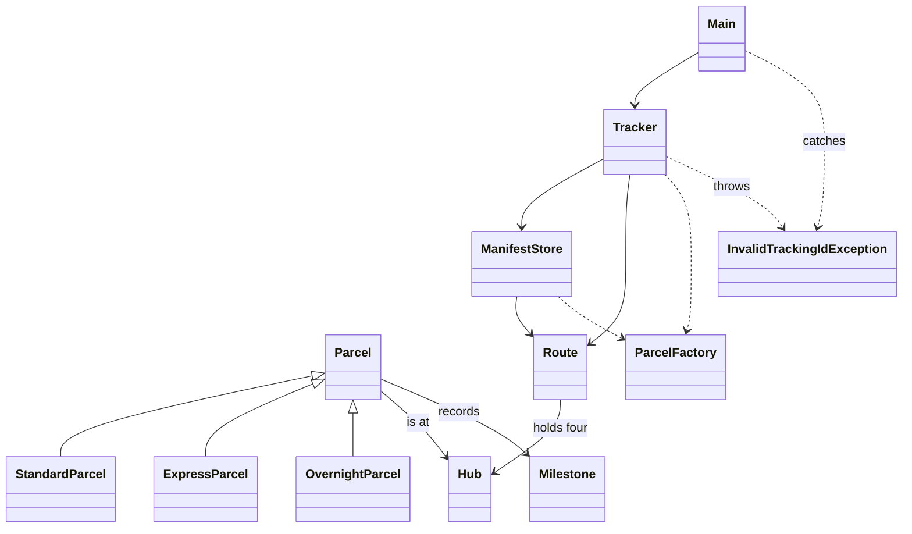

# 🧪 Design Options: Current Design and Plans to Improve It

> **Written for:** Group 8 members who must choose how far to go with OOP concepts before the lab evaluation.

This page compares the design in [BUILD-GUIDE.md](BUILD-GUIDE.md) with three possible plans. It is a draft for review. Every plan is a proposal. The spec asks for none of them, and [PROJECT-SPEC.md](PROJECT-SPEC.md) stays the only source of requirements.

## 🧱 Current design

The program has 12 Java files. Each file has one job.



The three speed classes differ only in the values that they pass to the `Parcel` constructor. They store the speed name, the delivery days, and the cost in fields. No method differs between them.

## 🔑 Keywords and features in use

| Feature | Where it appears | Does the project need it? |
| --- | --- | --- |
| Private fields with getters | Every class | Yes. Each class guards its own data. |
| Constructor and `this` | Every class | Yes. |
| `extends` and `super` | The three speed classes | Yes. The spec asks for inheritance for the speeds. |
| Constructor overloading | The two `Milestone` constructors | Yes. An event is either new or read from a file. |
| `static` | `main` and `ParcelFactory.makeParcel` | Yes. Both need no object. |
| `extends Exception`, `throw`, `throws`, `try`, `catch` | `InvalidTrackingIdException`, `Tracker`, `Main` | Yes. The spec asks for exception handling. |
| `ArrayList` and arrays | `Parcel`, `Tracker`, `Route`, `ManifestStore` | Yes. |
| `File`, `FileWriter`, `PrintWriter`, `Scanner` | `ManifestStore` | Yes. The spec asks for file saving. |

The code does not use `abstract`, `@Override`, `interface`, `enum`, or `protected`. The guide removed them because no part of the project needed them.

## 📊 Concept coverage today

| Concept | Covered | Note |
| --- | --- | --- |
| Objects, classes, and methods | Yes | |
| Encapsulation | Yes | |
| Inheritance | Yes, but weak | The subclasses add no behavior of their own. |
| Polymorphism | Weak | One list holds all three speeds, but no call runs different code for each speed. |
| Overriding | No | |
| Abstraction | No | |
| Overloading | Yes | |
| Strings, exceptions, and file input and output | Yes | |

The weak point is inheritance. A reader sees three classes with the same shape and different numbers. A viva question such as "Why do the subclasses exist?" has only a short answer.

## 🗺️ The plans

| Plan | Change | New keywords | Concepts it shows |
| --- | --- | --- | --- |
| Current | None | None | See the table above |
| Plan 1 | One method that works differently in each speed class | `abstract`, `@Override` | Overriding, abstraction, real polymorphism |
| Plan 2 | Replace `Hub` and `Route` with one `enum` | `enum`, `values()` | None new. It removes code. |
| Plan 3 | Keep only the classes that the spec names | None | None new. It reduces the class count. |

### 🔧 Plan 1: one method that differs by speed

Today the speed classes pass values to a constructor. In Plan 1, `Parcel` gets one `abstract` method. Each speed class overrides it with its own rule.

The rule must be real. A getter that returns a stored value does not count. The group must choose the rule, and the spec does not give one. This sketch uses made-up names and shows only the shape.

```java
// In Parcel: no body, each speed class must write its own
public abstract double calculateFee(int hubsPassed);

// In ExpressParcel: one rule
@Override
public double calculateFee(int hubsPassed) {
    return hubsPassed * EXPRESS_RATE; // EXPRESS_RATE is a number the group chooses
}

// In OvernightParcel: a different rule
@Override
public double calculateFee(int hubsPassed) {
    return OVERNIGHT_FLAT_FEE; // a number the group chooses
}
```

`Tracker` then calls `parcel.calculateFee(...)` on a `Parcel` variable. Java runs the code of the real speed class. This is polymorphism, and it is the clearest way to show it.

| Gain | Cost |
| --- | --- |
| Inheritance has a clear reason. | The group must write a fee rule that the spec does not give. |
| Overriding, abstraction, and polymorphism all appear in code that matters. | The `cost` field and `getCost` can become redundant. The group must decide which one stays. |
| An easy answer for "Why do the subclasses exist?" | The program needs one new output line, so the result is visible. |

### 🔧 Plan 2: an enum for the hubs

An `enum` is a fixed list of named values. Four constants, `DISPATCH`, `SORTING_FACILITY`, `OUT_FOR_DELIVERY`, and `DELIVERED`, can replace `Hub` and `Route`.

| Gain | Cost |
| --- | --- |
| Two files become one. | The spec names a `Hub` class. An enum is a different kind of type. |
| Finding the next hub needs less code. | Most beginners have not used enums in a lab. |
| | It shows no new OOP concept. |

### 🔧 Plan 3: only the spec's classes

The spec names `Parcel`, `Hub`, `Milestone`, and the three speeds. The design sketch adds the exception, `ManifestStore`, and `Main`. Plan 3 removes `Route`, `ParcelFactory`, and `Tracker`. It moves their work into `Hub`, `Parcel`, and `Main`.

| Gain | Cost |
| --- | --- |
| Three fewer files. | `Main` grows and takes back the long method inputs that `Tracker` removed. |
| The class list matches the spec exactly. | `Hub` needs static hubs or a hub list, which beginners find hard. |
| | Each file does more than one job again. |

## ✅ Recommendation

When the group can state the fee rule in one sentence, choose Plan 1 as the only change. Plan 1 is the one plan that adds an OOP concept. It builds on work that the spec already asks for, which is inheritance for the speeds.

Plans 2 and 3 do not add a concept. They trade clear files for fewer files. They conflict with the aim of simple code that each file explains in one sentence.

If the group cannot agree on a rule, keep the current design. It meets every item in the spec. Do not invent a rule only to use a keyword.

## ❓ Questions to settle first

- Does the group want Plan 1?
- If yes, what is the rule for each speed, and which number does it use?
- Does the `cost` field stay, or does `calculateFee` replace it?
- Does the lab faculty expect overriding and abstraction by name? The spec only says inheritance.

## 🎓 Other steps for the evaluation

These steps add no code.

- Make sure that each member can explain every file in one sentence, using the table in the build guide.
- Run the seven tests from the build guide as a live demo.
- Put the class diagram from this page in the project report.
