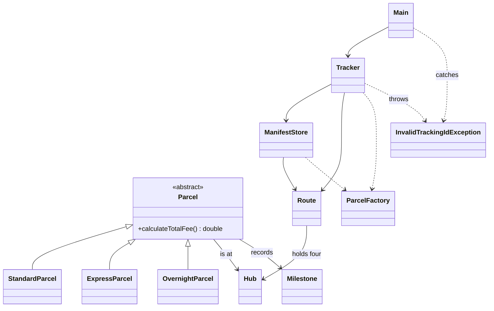

# 🧪 Design Options: Current Design and Plans to Improve It

> **Written for:** Group 8 members who must choose how far to go with OOP concepts before the lab evaluation.

This page compares the design in [BUILD-GUIDE.md](BUILD-GUIDE.md) with other plans. It is a draft for review. The spec asks for none of the plans, and [PROJECT-SPEC.md](PROJECT-SPEC.md) stays the only source of requirements.

> [!NOTE]
> The group chose Plan 1 with this rule: the base cost is `100`, and the total fee is the base cost plus the base cost divided by the delivery days. The build guide now holds this design.

## 🧱 Current design

The program has 12 Java files. Each file has one job.



`Parcel` stores the ID, the speed name, the delivery days, the base cost, the current hub, and the history. Each speed class passes its speed name and delivery days to `Parcel` with `super`. Each speed class also writes its own `calculateTotalFee` method.

## 🔑 Keywords and features in use

| Feature | Where it appears | Does the project need it? |
| --- | --- | --- |
| Private fields with getters | Every class | Yes. Each class guards its own data. |
| Constructor and `this` | Every class | Yes. |
| `extends` and `super` | The three speed classes | Yes. The spec asks for inheritance for the speeds. |
| `abstract` | `Parcel` and `calculateTotalFee` | Yes. No plain parcel exists, and each speed writes its own fee calculation. |
| `@Override` | The three speed classes | Yes. It marks the replacement of `calculateTotalFee`. |
| Constructor overloading | The two `Milestone` constructors | Yes. An event is either new or read from a file. |
| `static` | `main` and `ParcelFactory.makeParcel` | Yes. Both need no object. |
| `extends Exception`, `throw`, `throws`, `try`, `catch` | `InvalidTrackingIdException`, `Tracker`, `Main` | Yes. The spec asks for exception handling. |
| `ArrayList` and arrays | `Parcel`, `Tracker`, `Route`, `ManifestStore` | Yes. |
| `File`, `FileWriter`, `PrintWriter`, `Scanner` | `ManifestStore` | Yes. The spec asks for file saving. |

The code does not use `interface`, `enum`, or `protected`, because no part of the project needs them.

## 📊 Concept coverage today

| Concept | Covered | Where |
| --- | --- | --- |
| Objects, classes, and methods | Yes | Every class |
| Encapsulation | Yes | Private fields with getters |
| Inheritance | Yes | The three speed classes |
| Abstraction | Yes | The `abstract` class `Parcel` |
| Overriding | Yes | `calculateTotalFee` in each speed class |
| Polymorphism | Yes | `Tracker` holds one list of `Parcel`, and `getHistoryText` calls `calculateTotalFee` on each one |
| Overloading | Yes | The two `Milestone` constructors |
| Strings, exceptions, and file input and output | Yes | `Parcel`, `InvalidTrackingIdException`, and `ManifestStore` |

The weak point is that the formula is the same in all three speed classes. The code repeats it three times, and only the delivery days differ. A viva question such as "Why not write the formula once in `Parcel`?" has an honest answer: the group chose to practice overriding.

## 🗺️ The plans

| Plan | Change | New keywords | Concepts it shows | State |
| --- | --- | --- | --- | --- |
| Earlier design | Speed classes only pass values to `Parcel` | None | Inheritance, weakly | Replaced |
| Plan 1 | One `abstract` method that each speed class writes | `abstract`, `@Override` | Overriding, abstraction, polymorphism | Chosen |
| Plan 2 | Replace `Hub` and `Route` with one `enum` | `enum`, `values()` | None new. It removes code. | Open |
| Plan 3 | Keep only the classes that the spec names | None | None new. It reduces the class count. | Open |

### 🔧 Plan 1: one method that differs by speed (chosen)

`Parcel` declares `calculateTotalFee` as `abstract`. Each speed class overrides it. This is the shape in the build guide:

```java
// In Parcel: no body, each speed class must write its own
public abstract double calculateTotalFee();

// In ExpressParcel: Express passes 2 delivery days to Parcel
@Override
public double calculateTotalFee() {
    return getBaseCost() + getBaseCost() / getDeliveryDays();
}
```

With the placeholder delivery days, the totals are as follows.

| Speed | Delivery days | Base cost | Base cost / days | Total fee |
| --- | --- | --- | --- | --- |
| Standard | 5 | 100.0 | 20.0 | 120.0 |
| Express | 2 | 100.0 | 50.0 | 150.0 |
| Overnight | 1 | 100.0 | 100.0 | 200.0 |

| Gain | Cost |
| --- | --- |
| Inheritance has a clear reason. | The formula repeats in three classes. |
| Overriding, abstraction, and polymorphism all appear in code that matters. | The delivery days are placeholders until the group sets them. |
| The `track` output shows the result. | The spec does not name a fee. This is an addition of the group. |

### 🔧 Plan 2: an enum for the hubs

An `enum` is a fixed list of named values. Four constants, `DISPATCH`, `SORTING_FACILITY`, `OUT_FOR_DELIVERY`, and `DELIVERED`, can replace `Hub` and `Route`.

| Gain | Cost |
| --- | --- |
| Two files become one. | The spec names a `Hub` class. An enum is a different kind of type. |
| Finding the next hub needs less code. | Most beginners have not used enums in a lab. |
| | It shows no new OOP concept. |

### 🔧 Plan 3: only the spec's classes

The spec names `Parcel`, `Hub`, `Milestone`, and the three speeds. The design sketch adds the exception, `ManifestStore`, and `Main`. Plan 3 removes `Route`, `ParcelFactory`, and `Tracker`. It moves their work into `Hub`, `Parcel`, and `Main`.

| Gain | Cost |
| --- | --- |
| Three fewer files. | `Main` grows and takes back the long method inputs that `Tracker` removed. |
| The class list matches the spec exactly. | `Hub` needs static hubs or a hub list, which beginners find hard. |
| | Each file does more than one job again. |

## ✅ Recommendation

Keep Plan 1 as it is. It adds the OOP concepts through work that the spec already asks for, which is inheritance for the speeds.

Plans 2 and 3 do not add a concept. They trade clear files for fewer files. They conflict with the aim of simple code that each file explains in one sentence.

To remove the repeated formula later, the group has two choices. It can give each speed a different rule, so each override holds real logic. It can also move the formula into `Parcel` and drop the `abstract` method. The second choice removes overriding, so the first one fits the aim better. The spec does not ask for either.

## ❓ Questions to settle first

- Is the base cost of `100` final?
- What are the real delivery days for Standard, Express, and Overnight?
- Does the lab faculty expect any OOP concept that the table above does not cover?

## 🎓 Other steps for the evaluation

These steps add no code.

- Make sure that each member can explain every file in one sentence, using the table in the build guide.
- Run the seven tests from the build guide as a live demo.
- Put the class diagram from this page in the project report.
