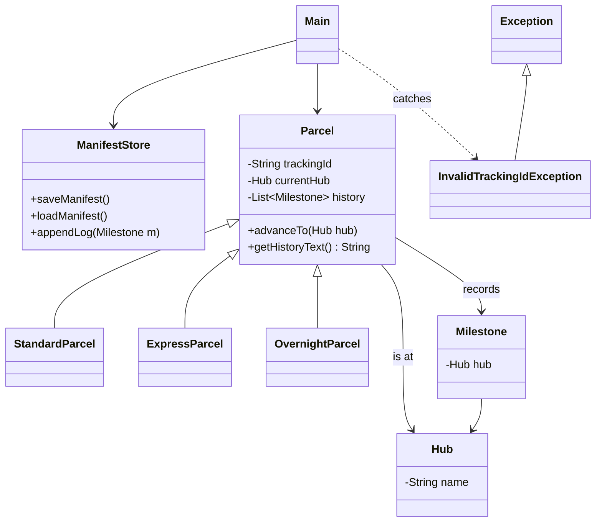

# 🧭 Design Sketch: Classes and a Sample Session

> **Written for:** Group 8 members who want to see how the parts fit together before coding.

This page is a sketch for review. The spec names `Parcel`, `Hub`, `Milestone`, the three speeds, the invalid ID exception, and the files. Every other name here is a proposal.

## 🧱 Classes

| Class | In spec | What it does |
| --- | --- | --- |
| `Parcel` | Yes | One shipment. Holds the tracking ID, the current hub, and the history. |
| Standard, Express, Overnight parcels | Yes | Subclasses of `Parcel`, one for each speed. |
| `Hub` | Yes | One transit hub. |
| `Milestone` | Yes | One tracking event. |
| `InvalidTrackingIdException` | Needed, name is a proposal | Signals a bad tracking ID. |
| `ManifestStore` | Needed, name is a proposal | Reads and writes the manifest and the status log. |
| `Main` | Needed, name is a proposal | Reads commands and prints the history. |



## 🔄 Sample session

The commands and messages are examples. The spec does not set them.

```text
> java Main add Express
Created parcel TRK1001 (Express) at Dispatch.

> java Main advance TRK1001
TRK1001 moved to Sorting Facility.

> java Main track TRK1001
Tracking history for TRK1001 (Express)
1. Dispatch
2. Sorting Facility

> java Main track ABC
Invalid tracking ID: ABC
```

What happens behind the screen:

- `add` creates a `Parcel` and saves it in `manifest.txt`.
- `advance` moves the parcel to the next hub. It adds a `Milestone` line to `status-log.txt`.
- `track` reads the saved data and prints the history.
- A bad ID throws the exception. The CLI catches it and prints a message.
